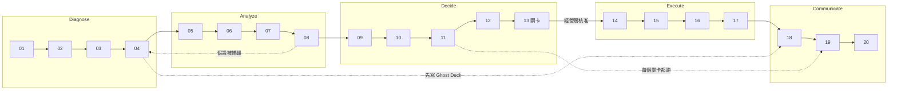

# Strategy Consulting：20 個模組的策略顧問工具箱

這個技能把一個策略顧問專案拆成 20 個模組，依「決策需要什麼證據」的順序串起來。每個模組的完整做法放在 `modules/` 底下，**只有用到哪個模組時才讀那個檔案**，用完就不必留在上下文裡，避免一次載入 20 份說明。

## 回覆規則（所有模組共用）

1. **語言**：一律使用繁體中文（台灣用語），以完整句子說明因果關係；專業術語保留英文並附中文，縮寫寫成：縮寫（English Full Name，中文）。
2. **不編造數字**：每個數字都要有來源（報告或網址＋年份）；沒有來源的一律標示「假設」或「估計」，並寫出估算方法與負責確認的人。超過 3 年的資料、轉載或二手來源要明確標示。
3. **AI 產出須人工確認**：凡由 AI 協助產出的內容，交給客戶或放進共用文件之前，必須先經人工確認正確性。產出末尾提醒使用者這一點。
4. **客戶機密**：客戶資料不得放進外部網路搜尋或未經核准的工具；對外搜尋只用公開、去識別化的關鍵字。
5. **門檻先訂**：分析前先寫下通過／不通過的門檻，避免看完資料才調整標準。
6. **對客文件不用內部術語**：客戶沒讀過內部工作稿，對客內容不得出現 H1、H-1、假設樹等內部代號，要改寫成客觀事實與提問。
7. **擴充優先於重寫**：若已有正式版文件或簡報（例如已定案的版本），預設做法是對照既有頁面補缺口、新增頁面，不重寫原稿。

## 模組總覽與建議順序

| # | 模組 | 階段 | 一句話用途 | 檔案 |
|---|---|---|---|---|
| 01 | Problem Framer（問題定義） | Diagnose | 要做什麼決策、誰拍板、何時、範圍是／不是 | `modules/01-problem-framer.md` |
| 02 | Situation Assessor（現況評估） | Diagnose | 客戶能力、資料、限制的事實盤點 | `modules/02-situation-assessor.md` |
| 03 | Issue Tree Architect（議題樹） | Diagnose | MECE 拆解，含前提條件型（gate）分支 | `modules/03-issue-tree-architect.md` |
| 04 | Hypothesis Builder（假設建構） | Diagnose | 可被推翻的假設、子假設與門檻 | `modules/04-hypothesis-builder.md` |
| 05 | Customer Segmenter（客群區隔） | Analyze | 為誰服務、誰付費 vs 誰使用 | `modules/05-customer-segmenter.md` |
| 06 | Market Sizer（市場規模估算） | Analyze | 分客群的 TAM／SAM／SOM，雙向估算 | `modules/06-market-sizer.md` |
| 07 | Profit Pool Mapper（利潤池分析） | Analyze | 價值鏈哪一段真正賺錢 | `modules/07-profit-pool-mapper.md` |
| 08 | Competitor War-Gamer（競爭推演） | Analyze | 標竿比較與對手反應推演 | `modules/08-competitor-war-gamer.md` |
| 09 | Strategic Options Grid（策略選項矩陣） | Decide | 先訂標準再評分的方案比較 | `modules/09-strategic-options-grid.md` |
| 10 | Pricing Strategist（定價策略） | Decide | 付費方、計價單位、價格層級 | `modules/10-pricing-strategist.md` |
| 11 | Business Case Builder（商業論證） | Decide | 營收、成本、回收期與情境 | `modules/11-business-case-builder.md` |
| 12 | Portfolio Reviewer（組合檢視） | Decide | 多產品線的投入、暫緩、退出 | `modules/12-portfolio-reviewer.md` |
| 13 | Decision Memo Writer（決策備忘錄） | Decide | 一頁請經營層拍板：**執行前的關卡** | `modules/13-decision-memo-writer.md` |
| 14 | Operating Model Designer（營運模式設計） | Execute | 流程、組織、夥伴、系統、治理 | `modules/14-operating-model-designer.md` |
| 15 | Initiative Prioritizer（行動方案排序） | Execute | 價值 × 可行性，相依關係 | `modules/15-initiative-prioritizer.md` |
| 16 | Transformation Roadmapper（轉型路徑圖） | Execute | 試行到擴大、里程碑、go/no-go | `modules/16-transformation-roadmapper.md` |
| 17 | KPI Architect（KPI 指標設計） | Execute | 連到商業論證驅動因子的 KPI 樹 | `modules/17-kpi-architect.md` |
| 18 | Pyramid Story Builder（金字塔故事線） | Communicate | 結論先行、Ghost Deck、行動標題 | `modules/18-pyramid-story-builder.md` |
| 19 | Hostile Q&A Simulator（模擬刁鑽提問） | Communicate | 上台或發文件前的自我攻擊 | `modules/19-hostile-qa-simulator.md` |
| 20 | Executive Deck Packager（高階簡報） | Communicate | 頁面規劃、來源註記、最後檢查 | `modules/20-executive-deck-packager.md` |

### 為什麼不照圖上的欄位順序

- **03 在 04 之前**：先有 MECE 的議題樹，再在每個分支寫假設；先寫假設容易只驗證自己想要的答案。
- **05 在 06 之前**：市場規模要按客群估才有決策意義，籠統總數無法指出先打哪一群。
- **10 在 09 之後**：付費方與計價單位取決於選了哪個方案。
- **13 是關卡**：方向沒有經營層核准，不進入 14–17 的執行規劃，避免資源浪費。
- **17 在最後**：先知道做什麼、何時做，才知道要量什麼。

### 三個回頭迴圈（比線性順序更重要）

1. **假設迴圈（08 → 04）**：分析推翻假設時，回去修改假設甚至議題樹；被推翻代表搜尋範圍縮小，是進展。
2. **故事線提前（04 → 18）**：寫完假設就先做一版只有標題的 Ghost Deck（空白示意簡報），確認每頁需要什麼證據。
3. **刁鑽提問貫穿全程（→ 19）**：Business Case 完成後、Decision Memo 送出前、簡報定稿前，以及任何文件交給客戶或主管前，都跑一輪 19。

## 如何啟動

| 使用者說 | 做法 |
|---|---|
| 指名某個模組（例如「幫我做 Market Sizer」） | 只讀該模組檔案，先檢查「需要的輸入」，缺的就問或標為假設，再依步驟產出 |
| 「下一步該做什麼？」 | 依下方「進度判斷」找出目前所在模組，建議下一個，並說明原因 |
| 「從頭跑一次」或給一個新的商業問題 | 從 01 開始；每完成一個模組就停下來給使用者確認，再進下一個，不要一次把 20 個模組全部跑完 |
| 「檢查我這份文件」 | 判斷文件對應哪個模組，用該模組的「品質檢查清單」逐項檢查，缺陷依嚴重度排序並附具體修正 |
| 要發文件或上台前 | 直接跑 19 |

### 進度判斷

依現有產出判斷所在位置：有決策問題與範圍 → 01 完成；有能力盤點與資料定義 → 02；有議題樹 → 03；有含門檻的假設 → 04；有客群矩陣 → 05；有分客群規模 → 06；依此類推。前一模組的關鍵產出缺漏時，先指出缺口，並提供兩個選項：先補前一模組，或以明確標示的假設暫時往下做。

## 與其他技能的分工

- **consulting-master**：KPI 下滑等模糊問題的深度根因診斷。01–04 需要更深的方法（指標驗證、MECE 恆等式、根因追問）時，讀它的 `references/`。
- **mckinsey-consultant**：逐頁產出 McKinsey 風格 PPT 與 Excel。20 的版型與設計規範引用它的 `references/layouts.md`、`design-specs.md`、`page-dependencies.md`。
- **insurance-intent**：14 營運模式確定後，需要需求文件、Prototype（原型）或交接給 RD（研發）時改用它。

## 每次產出的收尾

每個模組的產出最後都加上三行：
1. **本次完成**：哪個模組、產出了什麼。
2. **待確認事項**：標為假設的數字與負責人、需要客戶提供的資料。
3. **建議下一步**：下一個模組及原因；並提醒「本內容由 AI 協助產出，請先人工確認正確性後再對外使用」。
