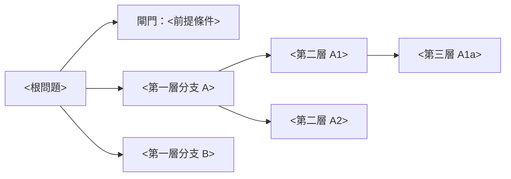

# 03 Issue Tree Architect（議題樹架構）
> 階段：Diagnose（診斷）｜上游輸入：01 problem-framer、02 situation-assessor｜交給下游：04 hypothesis-builder（並決定 05–08 分析模組的工作範圍）

## 這個模組要回答的問題
「要回答 01 的核心問題，必須拆成哪些互斥且窮盡的子議題，而且每個子議題都能被資料檢驗並對應到決策？」本模組產出一棵最多三層、通過 MECE（Mutually Exclusive, Collectively Exhaustive，彼此獨立、完全窮盡）測試的 Issue Tree（議題樹）。

## 什麼時候用、什麼時候不用
- **要用**：01 的 Question 已確認、02 的事實基礎已有初版時；分析結果顯示既有結構有大量無法解釋的殘差時（回到本模組補分支）；審查他人的議題樹時。
- **不用**：問題只有單一原因且已被資料證實時，直接進入量化與建議；若只是要條列工作項目而非拆解問題，用工作計畫即可，不必硬畫議題樹。
- 各產業常用的恆等式與 MECE 檢查細節見 `../../consulting-master/references/first-cut-identities.md` 與 `../../consulting-master/references/templates.md` 第 3 節。

## 需要的輸入
- 01 的 Question（根節點）、決策句與範圍框。
- 02 的已對齊指標定義、限制條件與資料可得性表。
- 指標類型（利潤、比率、成長、成本、週期時間）與對應的恆等式。
- 缺少任何一項時要先補問；無法取得的，寫成「假設」並標註確認負責人。

## 步驟
1. **選擇樹的類型**：Diagnostic tree（診斷型，回答「為什麼」）、Solution tree（解決方案型，回答「怎麼做」）、Conditions tree（條件型，回答「要成立，哪些條件必須同時為真」）。原則是先用診斷型找出病灶，再對領先選項用條件型證明。為什麼：同一層混用原因與解法，會讓分支無法比較，也無法判斷是否窮盡。
2. **用恆等式切第一刀**：依指標類型選恆等式（例如利潤＝營收－成本、比率＝分子÷分母、件數＝流量×轉換率），讓第一層天生 MECE。為什麼：恆等式在數學上互斥且窮盡，比憑經驗分類更不容易遺漏或重疊。
3. **每一層只用一個切分維度**：同一層的分支必須用同一個邏輯切開，且屬於同一種東西（全是原因、全是步驟、或全是方案；全是總量或全是單價）。通路、地區、產品、客群等區隔維度是「套用在每一個分支上的切片」，不是獨立分支。為什麼：維度混用會造成同一件事同時出現在兩個分支，分析時重複計算或互相推諉。
4. **做 20 元素 MECE 測試**：腦力激盪至少 20 個具體元素（事件、原因、項目），逐一放進分支；找不到家的代表有缺口，能放兩個家的代表有重疊。記得檢查常被遺忘的分支：衡量與定義、外部因素、供給面與需求面、一次性事件。為什麼：抽象標籤看起來都 MECE，只有具體元素能暴露真正的漏洞。
5. **寫邊界規則**：對灰色地帶（例如半變動成本、跨通路歸屬、同時受兩個原因影響的客戶）寫下明確歸屬規則。為什麼：誠實寫出「不完全 MECE，但我們用這條規則處理」比假裝沒有重疊更經得起質疑。
6. **控制深度為三層、每層 3–7 個分支**：第三層必須細到可以對應一個資料來源或一個負責人。為什麼：太淺無法檢驗，太深則分析量爆炸且無法在期限內完成。
7. **設定 Gate condition（閘門條件）**：找出必須先通過的前提分支（例如「資料定義一致」「法規允許」「市場規模足夠」），標示為閘門；若閘門不通過，其他分支的分析就不必進行或需要改變方向。為什麼：先檢驗閘門能避免在一個根本不成立的前提上投入大量分析。
8. **人工覆核並與團隊對齊**：AI 協助產生的分支須由團隊人工逐一檢查適用性，再放入共享文件。為什麼：自動產生的樹常看似完整，卻混入與本案範圍無關或維度不一致的分支。

## 產出範本
````markdown
# 議題樹（Issue Tree）
版本：<v0.x>｜樹的類型：<診斷型／解決方案型／條件型>｜根問題：<01 的 Question>

## 1. 樹狀結構

- 第一刀恆等式：<例如 指標＝分子÷分母>
- 每層切分維度：第一層 <>｜第二層 <>｜第三層 <>
- 套用到所有分支的區隔切片：<通路／地區／產品／客群……>

## 2. MECE 測試紀錄
| 具體元素（至少 20 個） | 歸屬分支 | 有無多個家／無家 | 處理方式 |
|---|---|---|---|

## 3. 邊界規則
| 灰色地帶 | 歸屬規則 | 理由 |
|---|---|---|

## 4. 閘門條件
| 閘門 | 通過標準（事先設定） | 檢驗資料與負責人 | 不通過時的處置 |
|---|---|---|---|

## 5. 分支可檢驗性
| 第三層分支 | 對應資料來源 | 負責人 | 與決策的關聯 |
|---|---|---|---|
````

## 品質檢查清單
- [ ] 已標明樹的類型，且同一層沒有混用原因、步驟與方案。
- [ ] 第一層使用恆等式切分，或已寫明為何沒有適用的恆等式。
- [ ] 每一層只有一個切分維度，區隔維度沒有被當成獨立分支。
- [ ] MECE 測試至少放入 20 個具體元素，且每個元素只有一個家。
- [ ] 灰色地帶都有書面邊界規則。
- [ ] 深度不超過三層，每層 3–7 個分支，第三層都對應到資料來源。
- [ ] 至少辨識出一個閘門條件，並事先寫好通過標準。
- [ ] 樹中沒有編造的數字；任何數字都標有來源或「假設／估計」。

## 常見錯誤
- **第一層用「內部／外部」或「人／流程／系統」這種鬆散分類**→ 元素在分支間游移，無法量化 → 改用恆等式切第一刀，鬆散分類留給根因分析的魚骨圖。
- **把通路或地區當成第一層分支**→ 每個通路下又重複出現價格、件數等相同子樹 → 把區隔維度改成切片，套用在每個分支上。
- **標籤式分支**（「營收問題」）→ 無法檢驗也無法指派 → 改寫成可量化的驅動因子（例如「平均保費下降」）。
- **忽略閘門條件**→ 花數週分析後才發現法規不允許或資料定義不一致 → 把前提條件放在樹的最前面先檢驗。

## 保險與跨境醫療服務情境提示
- 產險損失率可用「理賠頻率×平均理賠金額÷每單平均已賺保費」切第一刀，並以「當期事故年度與前期準備金發展」「毛額與淨額」「巨災與非巨災」作為邊界規則。
- 壽險新契約可依「接觸→需求分析→建議書→要保→核保→承保」的漏斗切分，通路作為切片而非分支；保單未續可切為「解約＋停效＋契撤」。
- 跨境醫療服務的條件型樹常見閘門包括：目的地法規允許該服務模式、支付與結算可行、合作醫療機構品質可驗證、健康資料跨境傳輸合規；任一閘門不過，市場吸引力分析就失去意義。
- 若議題樹同時涉及保險給付與醫療服務營收，應寫明營收歸屬的邊界規則，避免同一筆收入在兩個分支重複計算。

## 交給下一步
- 交給 **04 hypothesis-builder**：完整議題樹、閘門條件與通過標準、每個第三層分支的資料來源，作為撰寫可證偽假設與排序的骨架。
- 供 **05–08** 分析模組參考：哪些分支需要客群、市場規模、利潤池或競爭分析來檢驗。
